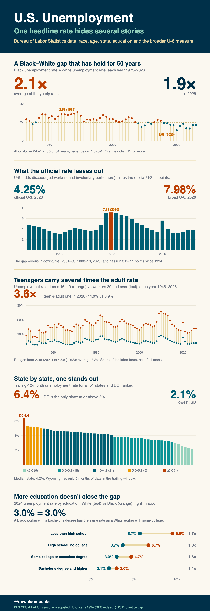
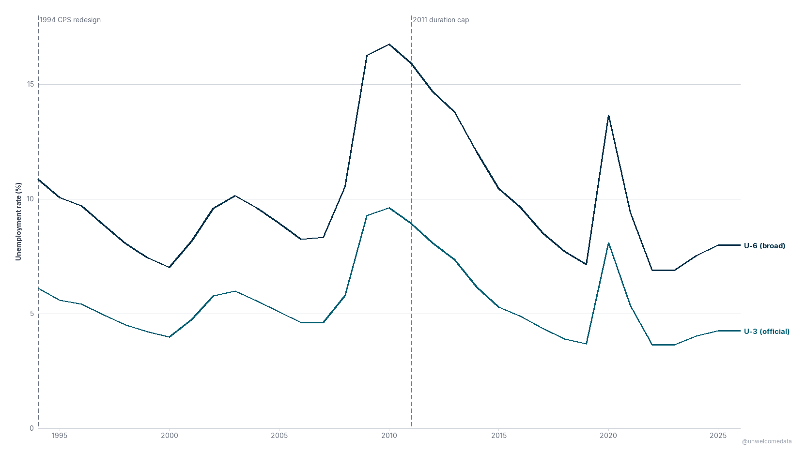
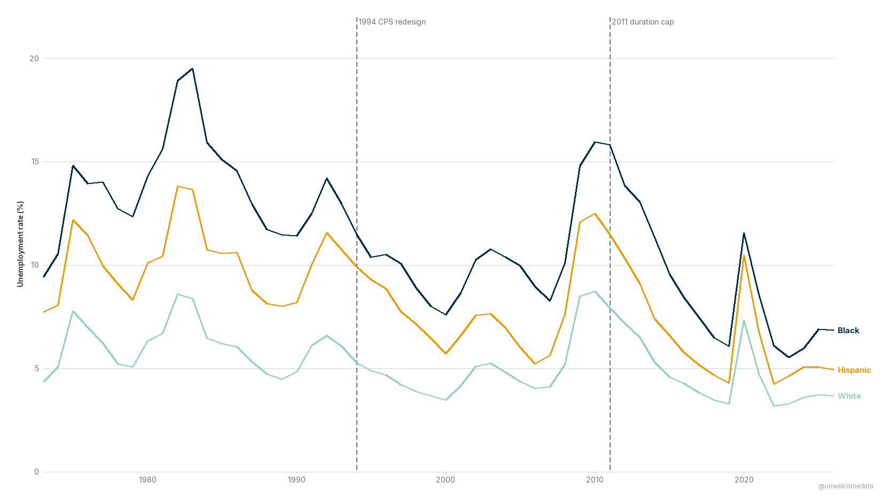
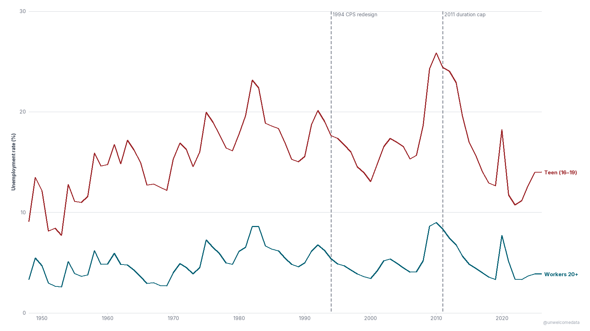
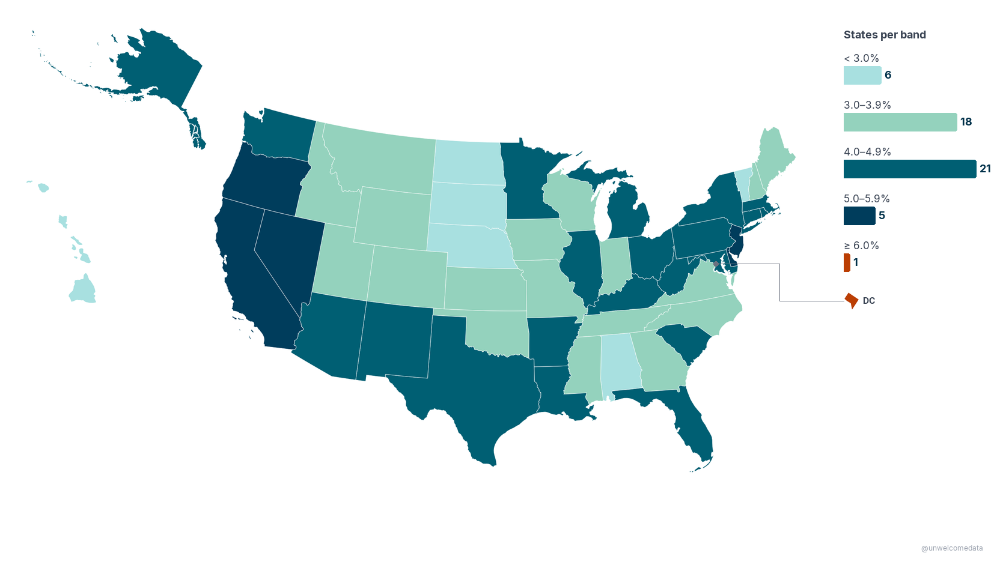
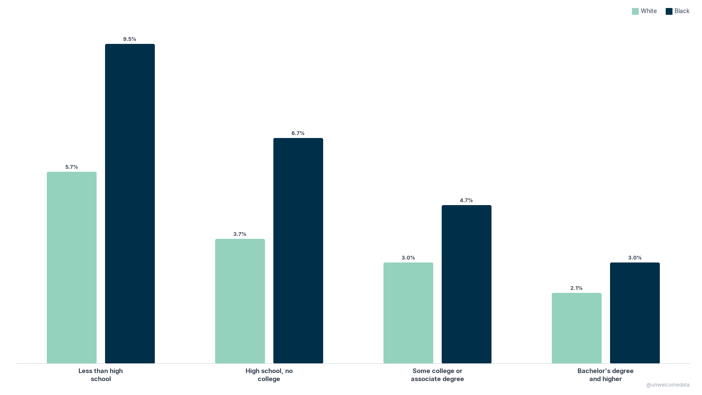

**[@unwelcomedata](https://github.com/unwelcomedata)** · data from public sources

# How U.S. unemployment has changed — and what the official rate hides

The headline unemployment rate is one number that hides several. This looks at U.S.
unemployment from four angles using public Bureau of Labor Statistics data: the gap
between the official rate and a broader one, how the burden splits by race and age,
and how it varies across states.

**The findings that held up (independently validated):**
- **The Black unemployment rate runs about twice the White rate — and it holds at
  every education level.** A Black worker with a bachelor's degree has roughly the
  same unemployment rate as a White worker with no college. Education does not close
  the gap.
- **The official rate (U-3) leaves a lot out.** The broader U-6 measure — which adds
  discouraged workers and involuntary part-timers — runs several points higher, and
  the gap between them widens sharply in every recession. That gap is "hidden"
  unemployment.
- **Teenagers are unemployed at more than twice the adult rate in every year on record** (2.3× to 4.6×, about 3.3× on average).
- **State rates vary widely**, and on a trailing-12-month average the District of
  Columbia is the lone jurisdiction at or above 6%.

---

[](docs/infographic_unemployment.png)

---

## The charts

_Annual averages unless noted. Click any chart to open it full size._

**The official rate vs the broad rate (U-3 vs U-6).** U-3 (official) = jobless,
available, and actively looked in the last 4 weeks, as a share of the labor force.
U-6 (broad) adds discouraged / marginally-attached workers plus involuntary
part-timers; the gap between the lines is hidden unemployment. The **1994 marker** is
the CPS redesign (which introduced U-4–U-6 and new job-search/duration questions — why
U-6 starts in 1994); the **2011 marker** is the duration cap (the max recorded
jobless-duration was raised from ~2 to ~5 years). Both are measurement changes, not
conclusions. Source: BLS CPS, retrieved 2026-09-28.

[](docs/01_u3_vs_u6.png)

**The racial unemployment gap over time.** Three lines — White, Hispanic, Black —
annual-average U-3, seasonally adjusted. Series start in different years (Black 1972,
Hispanic 1973), so they're comparable from 1973. The two dashed markers again flag
the **1994** CPS redesign and the **2011** duration cap (measurement changes, not
conclusions). The persistent ~2:1 Black/White gap is attributed mainly to
labor-market discrimination and occupational segregation — **not** education: it holds
at every education level, and hiring-audit studies find no decline since 1989.
Sources: BLS CPS; EPI 2015, 2019; Quillian et al. PNAS 2017; Fed FEDS 2017-071.

[](docs/02_race_gap.png)

**Teenagers vs adults.** Two lines: Teen (16–19) and Workers 20+ (BLS series
`LNS14000024`, the real combined-sex adult total that excludes teens). Annual-average
U-3, seasonally adjusted. Important: the rate is unemployed as a share of the **labor
force** (people working or actively looking), **not** of all teens — most teens are in
school and not in the labor force, so this is not "X% of all teenagers are out of
work." The teen rate runs at least twice the adult rate in every year on record (2.3× to 4.6×, about 3.3× on average). The **1994**
and **2011** markers are the same two measurement changes as above. Source: BLS CPS.

[](docs/03_youth_vs_adults.png)

**Unemployment by state.** A **trailing 12-month average** of each state's monthly
seasonally-adjusted U-3 rate (LAUS), window Jul 2025 – Jul 2026 (12 distinct monthly
periods spanning 13 calendar months because 2025-10 is absent). States are shaded in
five rate bands. **Wyoming** averages only 5 months (it reports through Dec 2025).
**DC** is the lone jurisdiction in the **≥ 6.0%** band — shown as the far-right callout
under the legend. (This 12-month average legitimately differs from any single-month
reading.) Source: BLS LAUS, retrieved 2026-09-28.

[](docs/04_state_map.png)

**Does education close the racial gap? No.** White vs Black unemployment within four
education tiers, workers 25+. In every tier the Black column is taller — a Black worker
with a bachelor's degree has about the same rate as a White worker with no college.
**Grain note:** this is a **2024 annual average, not seasonally adjusted**, from BLS
table `cpsaat07` — a different grain from the monthly seasonally-adjusted series behind
the other charts; the two are never co-plotted. The gap is attributed mainly to
labor-market discrimination and occupational segregation, not education. Sources: BLS
CPS, table cpsaat07; EPI 2015, 2019; Quillian et al. PNAS 2017; Fed FEDS 2017-071.

[](docs/05_race_gap_by_education.png)

---

## How it was measured

All data is from the U.S. Bureau of Labor Statistics (public domain). Three programs:

- **CPS (Current Population Survey)** — a monthly household survey of ~60,000
  households; the gold standard for labor-force measurement. The national rates
  (charts 1–3) and the race × education table (chart 5) come from CPS.
- **LAUS (Local Area Unemployment Statistics)** — the state rates (chart 4). LAUS is a
  **model-based estimate**, not a raw survey read: the small, noisy state CPS sample is
  run through a signal-plus-noise time-series model blended with unemployment-insurance
  claims and payroll (CES) data. Published state rates are periodically revised.
- **cpsaat07** — the annual CPS household table behind chart 5.

**Definitions that matter:**
- **U-3 (official):** jobless, available, and actively looked in the last 4 weeks ÷
  civilian labor force. **U-6 (broad):** U-3 plus discouraged/marginally-attached
  workers plus involuntary part-timers. They measure different populations by design —
  **never compare U-3 and U-6 as if they were the same series**; chart 1 shows both so
  the gap itself is the point.

**Series breaks / caveats that affect interpretation:**
- **1994 CPS redesign** — introduced the U-4–U-6 alternative measures and new
  job-search/duration questions (why U-6 history starts in 1994). The overall U-3 rate
  is broadly comparable before/after; some sub-series are not.
- **2011 duration cap** — the maximum recorded unemployment-*duration* category was
  raised from ~2 years (99 weeks) to ~5 years (260 weeks). This changes a measurement
  variable, **not** who counts as unemployed, so it does not shift the U-3/U-6 rate
  levels; it is marked only as context.
- **Race series start in different years** (White 1954, Black 1972, Hispanic 1973,
  Asian 2003), so cross-race comparisons start from 1973.
- **State rates (chart 4) are a trailing-12-month average**, which legitimately differs
  from a single month's reading, and LAUS estimates are model-based and get revised.
- **Chart 5 is a different grain** — annual-average, 25+, not seasonally adjusted, from
  cpsaat07 — and is never spliced or co-plotted with the monthly seasonally-adjusted
  series behind charts 1–4.
- **The race-gap interpretation is a cited attribution, not raw data.** The claim that
  the gap reflects discrimination and occupational segregation rather than education is
  attributed to EPI (2015, 2019), Quillian et al. (PNAS 2017), and Federal Reserve FEDS
  2017-071 — the chart data is what makes the "gap at every education level" fact
  visible; the *why* is sourced interpretation.

Full per-source collection methods, definitions, series breaks, and known
controversies are in [SOURCES.md](SOURCES.md).

---

## The data

The published datasets are in [`export/`](export/) (CSV + a plain-English codebook for
each):
- `unemployment_national_annual_v1.csv` — national annual-average rates (U-3/U-6, by
  race, by age) behind charts 1–3. (+ `_codebook.md`)
- `unemployment_states_trailing12_v1.csv` — each state's trailing-12-month-average rate
  behind chart 4. (+ `_codebook.md`)
- `unemployment_by_education_race_2024_v1.csv` — the 2024 race × education table behind
  chart 5. (+ `_codebook.md`)

The richer packaging (Excel, Parquet) and the full pipeline code are in the repo.

---

## Reproduce it

The published datasets rebuild from the raw BLS sources with one command:
```bash
python scripts/reproduce.py
```
It runs the full pipeline — **ingest → load → clean → prepare → export** — using the
logic in [`src/`](src/) (`ingest.py`, `clean_quality.py`, `prepare.py`). On the first
run it downloads the CPS/LAUS series and the cpsaat07 table (URLs in
[SOURCES.md](SOURCES.md)) into `data/raw/`; after that it runs offline. The output CSVs
match the published `export/*.csv`. The data-validation gate
```bash
python scripts/validate_charts.py   # exit 0 = safe to publish
```
re-derives every chart's figures from the built database and confirms the exports still
match. See [`scripts/README.md`](scripts/README.md) for options, run order, and the
required packages ([`requirements.txt`](requirements.txt)).

---

## Further exploration

- Add **Asian** as a fourth race line on the gap chart (the CPS Asian series begins
  2003).
- **Metro-level LAUS** — the same trailing-average view at the metro-area grain.
- **Recession shading** on the time-series charts to make the U-3/U-6 widening and the
  racial-gap cyclicality read at a glance.
- **Duration and reason-for-unemployment cuts** (long-term unemployment share, job
  losers vs leavers vs new entrants), mindful of the 2011 duration-cap break.

---

> **AI-Assisted Development**
> This project was built with the assistance of [Kiro](https://kiro.dev), an
> AI-powered development environment. All data-sourcing decisions, methodology
> choices, and published findings are the responsibility of the author. AI was used
> for code generation, data-pipeline construction, and research assistance — not for
> analysis conclusions or editorial judgment.
